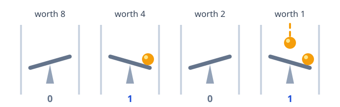

<!--
author: Kyle
version: 0.2.0
language: en
comment: Adding machines, algorithms, and programmes, before any electronics.
-->

# A machine that adds

*[From the Silicon Up](https://liascript.github.io/course/?https://raw.githubusercontent.com/LordParsley/from-the-silicon-up/main/course.md) - Before the Silicon, lesson 0*

Before we meet a real computer, it is worth asking a stranger question: could you build an adding machine with no electricity in it at all?

People were building calculators long before electricity. In 1642, Blaise Pascal built one from gears and dials to help with his father's tax work. Water has even had a go: in 1949 the economist Bill Phillips built the MONIAC, a computer that modelled a whole national economy with water flowing through tanks and pipes. But water computes with levels, not digits.

The clearest little adding machine of all uses something humbler: marbles, wood, and gravity. It really exists - people build them as workshop projects - and its one moving part works exactly like the switches inside a real chip.

This lesson has no simulator and nothing to install. Allow about 25-30 minutes. The three ideas here (adding with carries, algorithms, and programmes) are the foundation for everything that follows.

## The marble adding machine

Picture a row of four wooden rockers, like tiny see-saws, side by side. Each rocker tips to the left or the right. That is the whole memory of our machine.

A rocker tipped to the right means `1`. Tipped to the left means `0`.

Each rocker has a value. Reading left to right, they are worth 8, 4, 2 and 1. The number the machine stores is the sum of the values of the rockers showing `1`.

Our machine, storing the number 5 (only the rockers worth 4 and 1 are tipped to 1, and 4 + 1 = 5):

**Try it.** Click a rocker to tip it, and watch the stored number on the far right. The marble button drops one marble into the rightmost column (add 1) - watch what happens when a rocker already shows `1`.

worth 8<button class="wam-lock" data-value="8" data-full="0" style="width:76px; height:56px; font-size:1.3em; border:2px solid #94a3b8; border-radius:8px; background:#e5e7eb; color:#374151; cursor:pointer;">0</button>worth 4<button class="wam-lock" data-value="4" data-full="0" style="width:76px; height:56px; font-size:1.3em; border:2px solid #94a3b8; border-radius:8px; background:#e5e7eb; color:#374151; cursor:pointer;">0</button>worth 2<button class="wam-lock" data-value="2" data-full="0" style="width:76px; height:56px; font-size:1.3em; border:2px solid #94a3b8; border-radius:8px; background:#e5e7eb; color:#374151; cursor:pointer;">0</button>worth 1<button class="wam-lock" data-value="1" data-full="0" style="width:76px; height:56px; font-size:1.3em; border:2px solid #94a3b8; border-radius:8px; background:#e5e7eb; color:#374151; cursor:pointer;">0</button>= 0<button id="wam-add" style="vertical-align:bottom; height:56px; padding:0 14px; border:2px solid #1d4ed8; border-radius:8px; background:#eff6ff; color:#1d4ed8; cursor:pointer;">drop a marble (add 1)</button>

Here is the machine storing the number 5. Only the rockers worth 4 and 1 show `1`, and 4 + 1 = 5:

| worth 8 | worth 4 | worth 2 | worth 1 | number stored |
| --- | --- | --- | --- | --- |
| 0 | 1 | 0 | 1 | 5 |

And here are six different numbers side by side. Read **down a column** to see the four rockers for that number:

| Rocker | Storing 0 | Storing 1 | Storing 2 | Storing 3 | Storing 4 | Storing 5 |
| --- | --- | --- | --- | --- | --- | --- |
| worth 8 | 0 | 0 | 0 | 0 | 0 | 0 |
| worth 4 | 0 | 0 | 0 | 0 | 1 | 1 |
| worth 2 | 0 | 0 | 1 | 1 | 0 | 0 |
| worth 1 | 0 | 1 | 0 | 1 | 0 | 1 |

Reading a column from top to bottom gives a pattern like `0101`, which means 5. This way of writing numbers is called **binary**, and it is exactly how computers store numbers, using tiny switches instead of rockers.

With four rockers, the largest number we can store is `1111` = 8 + 4 + 2 + 1 = 15. Drop one marble too many and every rocker flips back to `0`: the marble falls clean out of the machine, and the count starts again at 0. Real machines, wooden and silicon alike, do this too; it is called **overflow**.

## 1. Read the machine

The rockers show, left to right: `1`, `0`, `1`, `0`.

What number is stored?

[[10]]

Worked answer

The rockers worth 8 and 2 show `1`. The others contribute nothing.

8 + 2 = 10.

With four rockers, the largest number we can store is `1111` = 8 + 4 + 2 + 1 = 15.

## One rule for adding

Here is the whole trick. To **add 1**, drop a marble into the rightmost column (the one worth 1), and follow this rule:

> When a marble lands on a rocker: if the rocker shows `0`, it tips to `1` and catches the marble, and you stop. If the rocker shows `1`, it tips back to `0` and the marble rolls on to the next column to the left, which follows the same rule.

Watch it add 1 to 3 (`0011`):

- The marble lands on the 1-rocker. It shows `1`, so it tips to `0` and the marble rolls left to the 2-rocker.
- The 2-rocker shows `1`, so it tips to `0` and the marble rolls left to the 4-rocker.
- The 4-rocker shows `0`, so it tips to `1` and catches the marble. Stop.

The pattern is now `0100`, which is 4. We just computed 3 + 1 = 4.

That moment when a rocker tips back to `0` and sends the marble one column left is called a **carry**. You already know carries from school arithmetic: 7 + 5 makes 12, so you write down 2 and carry the 1. Our rockers carry whenever they pass 1, because a rocker can only hold 0 or 1.

## 2. Run the machine

The rockers show `0111` (that is 7). Follow the rule and add 1.

What is the new pattern? Type four digits.

[[1000]]

Worked answer

- The 1-rocker shows `1`: it tips to `0`, the marble rolls left.
- The 2-rocker shows `1`: it tips to `0`, the marble rolls left.
- The 4-rocker shows `1`: it tips to `0`, the marble rolls left.
- The 8-rocker shows `0`: it tips to `1` and catches the marble. Stop.

The pattern `0111` becomes `1000`: the number 8. The marble travelled through three rockers before finding one showing `0`.

Adding bigger numbers, subtracting, even multiplying, can all be built from this one idea with a few more rules. Real processors do exactly this, with electricity standing in for marbles.

## The rule is an algorithm

Notice what kind of thing our adding rule is:

- It is a **finite** list of steps.
- Every step is **completely mechanical**: "if the rocker shows `1`, tip it to `0` and send the marble left" requires no judgement, no cleverness, no guesses.
- It **always works**, for any starting pattern.

A set of steps like that is called an **algorithm**: a recipe so precise that a machine, or a person following it thoughtlessly, gets the right answer every time. Long division is an algorithm. A cake recipe mostly is one. "Season to taste" is not, because it asks for judgement.

In the 1930s, the mathematician Alan Turing asked a daring question: is there a single kind of machine that could follow *any* algorithm? His answer, the **Turing machine**, is a hypothetical device that reads and writes symbols on a tape by following rules exactly as simple as our marble rule. Turing showed this humble machine can compute anything that any algorithm can compute. Every computer ever built, from the marble adder to your phone, is one of these machines wearing different clothes. That claim is called the **Church-Turing thesis**, and nothing has ever broken it.

## 3. Spot the algorithm

Which of these is an algorithm?

[[X]] To add 1: drop a marble into the rightmost column. When it lands on a rocker showing `0`, the rocker tips to `1` and catches it; on a `1`, the rocker tips to `0` and the marble rolls left.
[[ ]] Keep dropping marbles around the machine until the answer feels right.
[[ ]] Ask the machine politely to think of a bigger number.

Worked answer

Only the first one. It has fixed steps, needs no judgement, and always finishes.

"Until it feels right" and "think of a number" both sneak in judgement or magic. An algorithm is exactly the part of problem-solving that needs neither. That is why it can be handed to a machine.

## Some problems have no recipe

If any algorithm can be followed by a machine, it is tempting to believe every question has an algorithm. Turing proved otherwise.

The most famous example: the **halting problem**. Programmes sometimes get stuck in loops that never end. It would be wonderful to have a "loop detector": a programme that reads any other programme and always answers correctly, "this one stops" or "this one runs forever".

Turing proved in 1936 that no such programme can exist. Not that we have not invented it yet, but that it is impossible, the way a square circle is impossible. Any machine you could ever build will either answer wrongly on some programmes or spin forever without answering.

So problems split in two:

- **Computable**: an algorithm exists. Adding numbers, sorting names, finding the shortest route between two towns.
- **Non-computable**: no algorithm exists, and none ever will. Telling, in general, whether an arbitrary programme halts is the classic case.

This is a surprising and powerful fact: there are questions with definite answers that no machine, however fast or large, can answer in general.

## 4. Computable or not?

You are given any map and two towns. Is there an algorithm that always finds the shortest route between them?

[[X]] Yes: try the routes in a fixed order and keep the shortest. Slow, maybe, but mechanical.
[[ ]] No: every map is different, so no single recipe can cover them all.

And the loop detector: a programme that reads any programme and always says whether it halts?

[[ ]] Yes: a fast enough computer could check every case.
[[X]] No: Turing proved no algorithm can do this for every possible programme.

Worked answer

Shortest route: computable. One fixed recipe (list every route, measure each, keep the shortest) works on every map. Being slow does not make a problem non-computable.

The loop detector: non-computable. Speed is not the issue. Even infinitely fast hardware cannot fix the problem Turing found, because the contradiction is in the question itself.

## The programme is data too

One more idea, and it might be the deepest.

Our marble machine had its rule drilled into whoever operated it. But we could write the rule down: "when a marble lands on a rocker, if it shows `1` then tip it to `0` and send the marble left, else tip it to `1` and catch it". Written down, the rule is just symbols on paper: **data**.

Now imagine a machine that reads its rules from the same place it keeps its numbers. Feed it the adding rules and it adds. Feed it different rules and it sorts names, or plays music, without changing a single rocker or rail. That is a **universal machine**, and it is what a computer is.

A music box works this way: the tune is not built into the box, it is a pattern of bumps on a metal cylinder, and swapping cylinders swaps the song. Early looms wove patterns from punched cards. A modern computer stores its programmes in memory, as numbers, right next to the numbers they work on.

This is why coding is the way it is:

- **A programme is a file.** Instructions are stored as data, so they can be saved, copied, shared and edited like any document.
- **Programmes can work on programmes.** The tools that turn the code you write into running machine instructions (compilers and interpreters) are themselves programmes that read programmes as their input.
- **One machine, every job.** Because the programme lives in memory, the same computer can be a calculator, a text editor or a game just by loading different data. You never rebuild the hardware.

Whenever you hear that "code is data", this is the idea underneath.

## 5. Where does the programme live?

In a modern computer, where are the running programme's instructions stored?

[[ ]] In a special part of the machine that only holds instructions.
[[X]] In the same memory as the data the programme works on.
[[ ]] Nowhere: the instructions are wired into the circuits.

Worked answer

In the same memory as the data. Instructions and data are both just numbers in memory, which is what makes the computer universal: loading a different programme is loading different numbers.

Wiring the instructions into the machine was how some very early computers worked. Reprogramming them meant moving cables by hand. Storing the programme in memory instead, the "stored-programme computer", is the idea every modern machine is built on.

## What you have built

- A working mental model of a mechanical adder: rockers that tip between `0` and `1`, carrying by passing the marble left. Binary is just tipped-and-untipped written down.
- A definition of an **algorithm**: finite, mechanical, always right.
- A boundary: some problems are **non-computable**, proven so, not just waiting for faster hardware.
- The trick that makes computers universal: the **programme is data**, stored in the same memory it works on.

Before finishing, explain these in your own words:

- Why does adding 1 to `0111` tip every rocker?
- What makes "season to taste" fail as an algorithm?
- Why can the same computer run a game and a spreadsheet without new hardware?

Next: [A computer you can watch](https://liascript.github.io/course/?https://raw.githubusercontent.com/LordParsley/from-the-silicon-up/main/little-machine/lesson-01.md), where we meet a real (tiny) machine that stores both its instructions and its data in memory, and we make it compute.

[Back to the course home](https://liascript.github.io/course/?https://raw.githubusercontent.com/LordParsley/from-the-silicon-up/main/course.md)

## References

- [Matthias Wandel's binary marble adding machine](https://woodgears.ca/marbleadd/) - the real wooden machine this lesson is modelled on, with plans and a video.
- [The Halting Problem, Computerphile](https://www.youtube.com/watch?v=macM_MtS_w4) - a friendly video proof of why the loop detector cannot exist.
- [Turing's 1936 paper, "On Computable Numbers"](https://www.cs.virginia.edu/~robins/Turing_Paper_1936.pdf) - where the universal machine first appears, for the curious.
- [Pascal's calculator](https://en.wikipedia.org/wiki/Pascal%27s_calculator) - the 1642 gear-driven adding machine.
- [The MONIAC](https://en.wikipedia.org/wiki/Phillips_Machine) - the 1949 water-powered computer.
